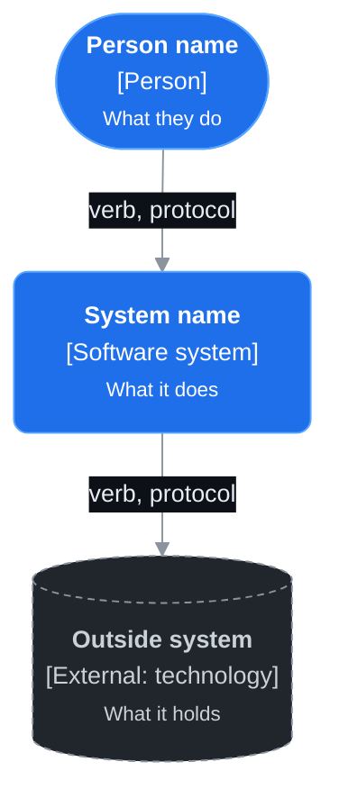
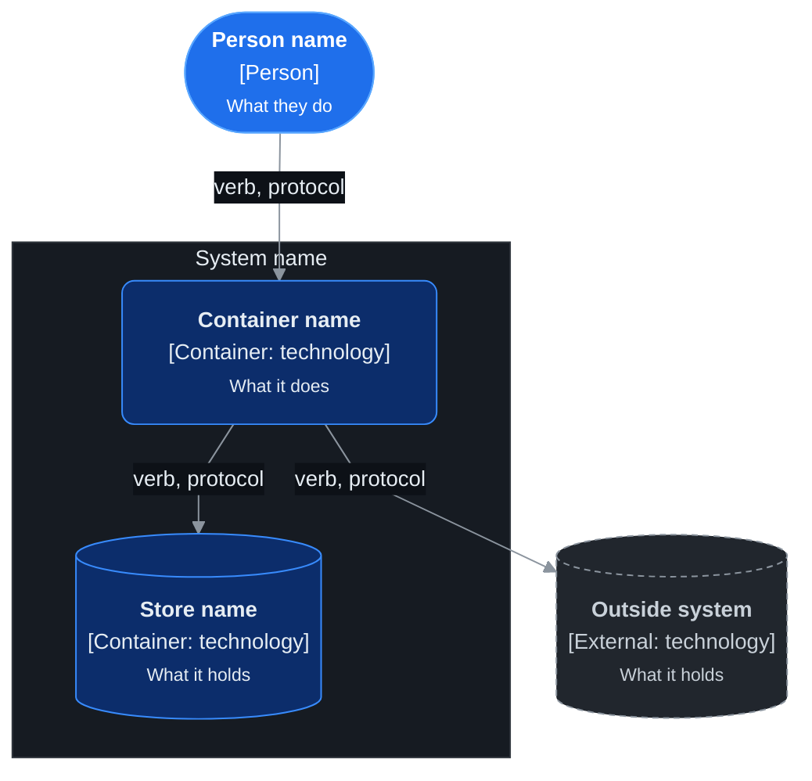
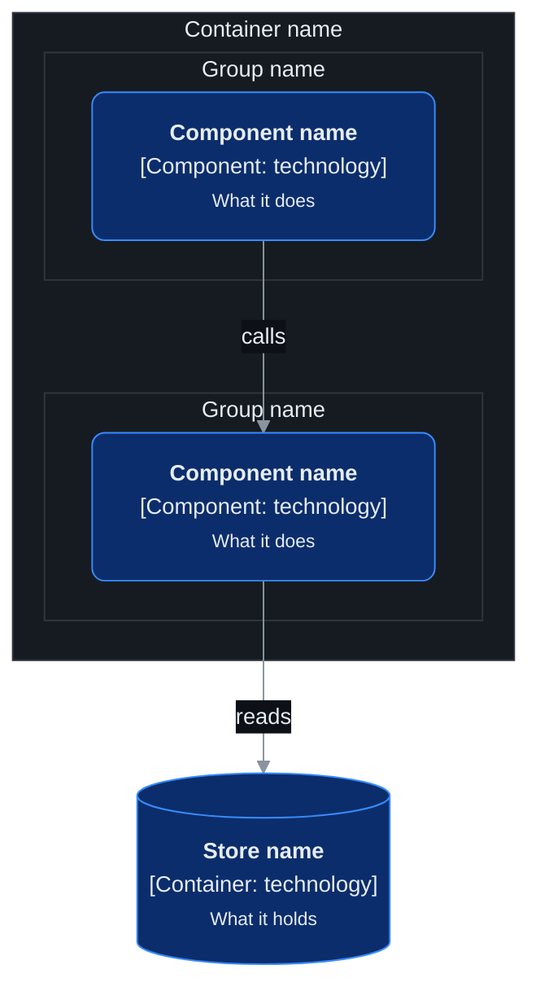
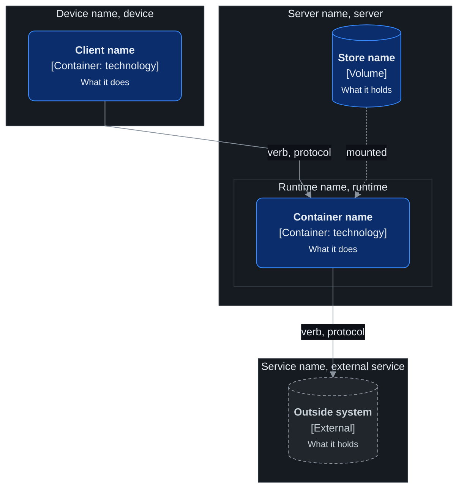
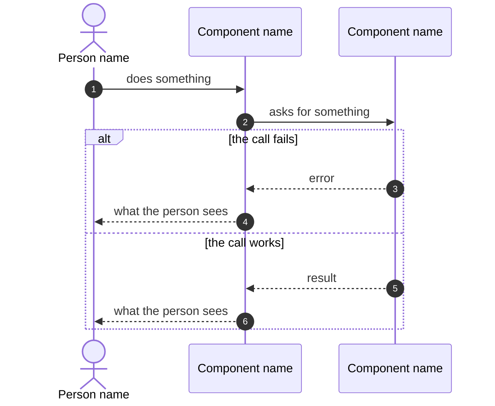

# Diagram templates

The five templates of the [architecture-docs](SKILL.md) skill. [DIAGRAMS.md](DIAGRAMS.md) has the rules. Copy a template. Keep the `%%{init}%%` line and the `classDef` lines as they are. Change only the nodes, the subgraphs and the arrows.

## Template 1: C4 level 1, system context

Question it answers: who uses the system, and which outside systems does it depend on?

## Template 2: C4 level 2, containers

Question it answers: which parts that run or hold data make up the system, and how do they talk?

## Template 3: C4 level 3, components

Question it answers: which parts make up one container, and which part can call which?

## Template 4: deployment

Question it answers: on which machine does each container run, and what connects the machines?

A subgraph is a machine, a device or a service that runs things. Put a subgraph for a runtime inside its machine, such as Docker inside a server.

## Template 5: sequence

Question it answers: what happens, in order, when one thing occurs?

- The person or the system that starts the flow is the first participant, as an `actor`.
- The participants are persons, containers, components, outside systems or machines from the other diagrams, with the same names.
- `autonumber` is on.
- A solid arrow `->>` is a call. A dashed arrow `-->>` is its answer.
- Each way the flow can fail is a branch of an `alt` block, with the failure first.

